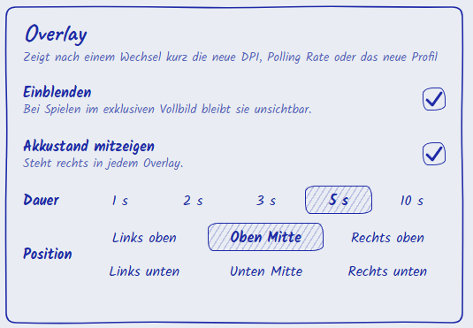
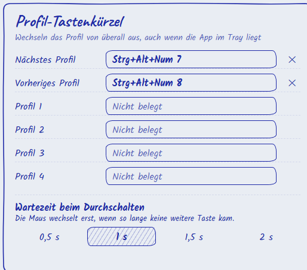
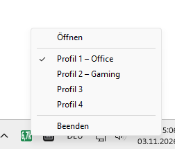

# H-Mouse Config

Unofficial configuration app for the Lofree Hypace.

A small Windows desktop app to configure the Lofree Hypace mouse without the
vendor's website. Built with Rust and Tauri 2, the interface is available in
German and English.

**This is an independent project with no connection to Lofree.** All trademarks
belong to their owners. Use at your own risk: the app writes settings to the
mouse, and nothing here is tested or endorsed by the manufacturer.


| | |
|---|---|
|  |  |
|  | |

## Features

- Button assignments, key combinations and macros, also a profile switch and a DPI lock on a
  mouse button; the profile switch can be put on the same button in all profiles at once
- DPI stages, polling rate, lift-off distance and other sensor settings
- Receiver light
- Four profiles with your own names; the active profile can be copied into any of the others
- Export and import of the configuration
- Tray icon with DPI and battery colour, quick profile switching, start with Windows
- Overlay with the new DPI, polling rate or profile and the battery level
- Profile hotkeys that work from anywhere
- Bluetooth: the window shows the connection and battery level, and the tray icon shows the
  battery percentage instead of the DPI. Over Bluetooth the mouse reports only its battery level,
  so settings and profiles are locked and need the receiver or the cable

### What the vendor software does not offer

Compared with Lofree's own web tool for the Hypace, this app adds:

| | H-Mouse Config | Vendor web tool |
|---|---|---|
| Runs as | Windows app in the tray, starts with Windows | page in Chrome, Edge or Opera (WebHID) |
| Connection | found automatically, the cable wins over the receiver | picked by hand in the browser |
| Profile names | your own names | Profile#01 to #04 |
| Copy a profile into others | yes | no |
| Profile switch and DPI lock on a mouse button | yes | known to the firmware, not offered |
| Profile hotkeys on the keyboard | yes, from anywhere | no |
| Overlay after a DPI, polling or profile switch | yes, with battery level | no |
| Tray icon | active DPI, background by battery level, profile menu | no |
| Battery | own voltage curve, charging state, raw value and voltage | value reported by the mouse |
| Bluetooth | shows connection and battery | not supported |
| Languages | German, English | English, Chinese |

Firmware updates and pairing a new receiver are deliberately not included; use the vendor's tool
for those.

The battery percentage is an estimate from a voltage curve measured over one full
discharge of one mouse, so it can differ from the real charge.

## Overlay



After a switch a small box shows the new value for a few seconds, for example `1600 DPI`,
`1000 Hz` or `Profile 2 – Gaming`, with the battery level on the right. It reacts to the DPI and
polling buttons of the mouse, to the tray menu and to the profile hotkeys. Changes made in the
app window itself stay quiet, because the window shows them anyway.

The box appears on the screen of the window in front. It covers games in windowed or borderless
mode, but stays hidden in exclusive fullscreen. On or off, the battery level, the duration
(1 to 10 seconds) and one of six places on the screen are set under Settings.

## Profile hotkeys



Any key combination can switch to the next, the previous or a certain profile, also while the
app sits in the tray. Windows hands a registered combination to this app alone, so other
programs no longer receive it.

- Cycling with next or previous shows each target at once, but the mouse switches only after a
  pause without further presses (0.5 to 2 seconds, 1 by default). So it reads just the profile
  it lands on. The keys for a certain profile switch at once.
- If the mouse sleeps, the overlay says so, and the switch follows as soon as the mouse is
  moved within a minute.
- Combinations that Windows keeps for itself, such as Ctrl+Alt+Del or Win+L, are refused. A
  combination that another program already holds is marked in red.
- Warnings name what a combination takes away elsewhere: AltGr characters of the current
  keyboard layout (Ctrl+Alt+Q types @ on a German keyboard), common shortcuts, the overlays of
  NVIDIA, AMD, Steam and the Xbox Game Bar, and keys without Ctrl, Alt or Win.
- With NumLock off the numpad sends navigation keys instead of digits. The field shows the key
  Windows registered, with the note "Learned with NumLock off".

## Tray



The tray icon shows the active DPI on a background that follows the battery level; thresholds
and colours are set under Settings. Over Bluetooth it shows the battery percentage instead. A
left click opens the window, the menu switches between the profiles with their own names.

## Download

Get the ZIP from the [releases page](https://github.com/RicardoHipp/h-mouse-config/releases),
unpack it and start `h-mouse-config.exe`. The EXE is not signed, so Windows may show
a SmartScreen warning.

## Building

You need [Rust](https://rustup.rs) with the Microsoft C++ build tools, which the
Rust installer offers to set up. Running the app needs WebView2, which Windows 11
already includes. Node is not required.

```bash
build.bat
```

The EXE ends up in `release`. `build-final.bat` takes longer and produces a smaller file.

## Credits

- Fonts: [Kalam](https://fonts.google.com/specimen/Kalam) and
  [Caveat](https://fonts.google.com/specimen/Caveat), SIL Open Font License,
  licences in `app/ui/fonts`
- The drawings of the mouse and receiver were generated with AI from the author's own photos

## License

MIT, see [LICENSE](LICENSE). The fonts keep their own licence.
