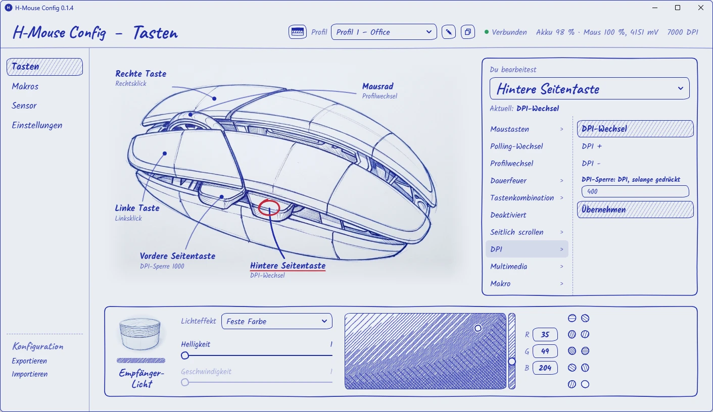
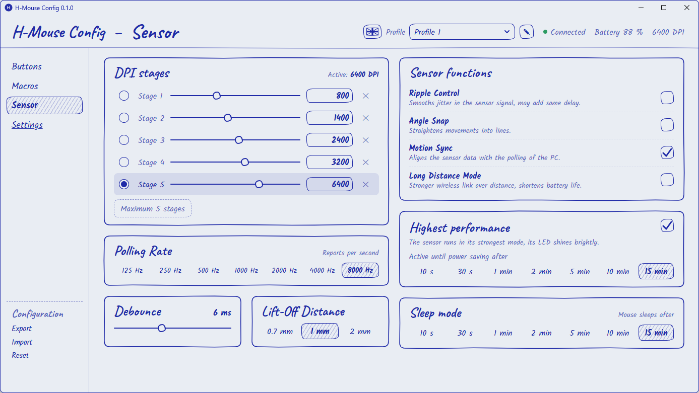
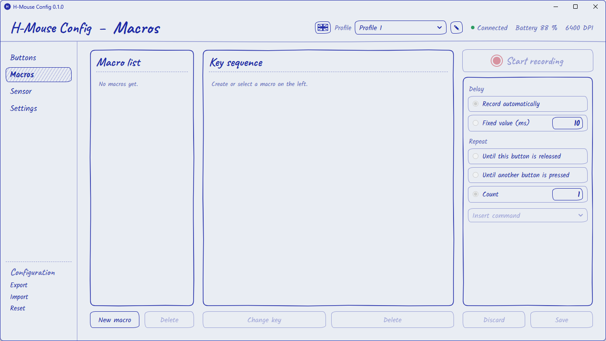
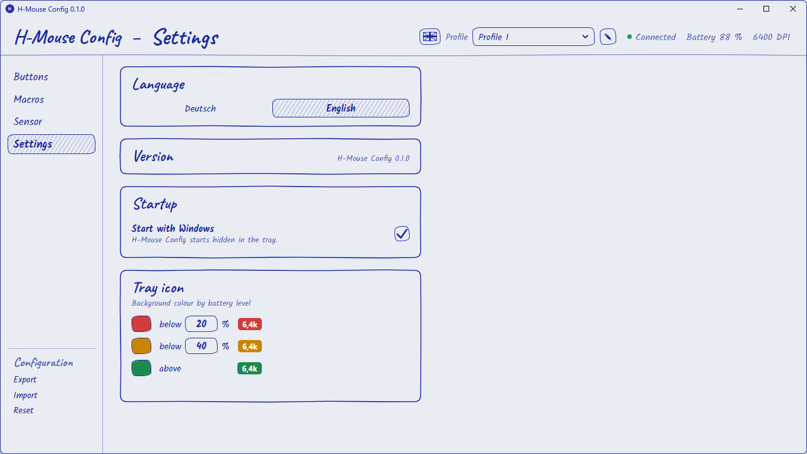

# H-Mouse Config

Unofficial configuration app for the Lofree Hypace.

A small Windows desktop app to configure the Lofree Hypace mouse without the
vendor's website. Built with Rust and Tauri 2, the interface is available in
German and English.

**This is an independent project with no connection to Lofree.** All trademarks
belong to their owners. Use at your own risk: the app writes settings to the
mouse, and nothing here is tested or endorsed by the manufacturer.



| | |
|---|---|
|  |  |
|  | |

## Features

- Button assignments, key combinations and macros
- DPI stages, polling rate, lift-off distance and other sensor settings
- Receiver light
- Four profiles with your own names
- Export and import of the configuration
- Tray icon with DPI and battery colour, quick profile switching, start with Windows
- Over Bluetooth the mouse reports only its battery level, which the window and the tray icon show;
  settings need the receiver or the cable

Firmware updates are deliberately not included.

The battery percentage is an estimate from a voltage curve measured over one full
discharge of one mouse, so it can differ from the real charge.

## Download

Get the ZIP from the [releases page](https://github.com/RicardoHipp/h-mouse-config/releases),
unpack it and start `h-mouse-config.exe`. The EXE is not signed, so Windows may show
a SmartScreen warning.

## Building

You need [Rust](https://rustup.rs) with the Microsoft C++ build tools, which the
Rust installer offers to set up. Running the app needs WebView2, which Windows 11
already includes. Node is not required.

```bash
build.bat
```

The EXE ends up in `release`. `build-final.bat` takes longer and produces a smaller file.

## Credits

- Fonts: [Kalam](https://fonts.google.com/specimen/Kalam) and
  [Caveat](https://fonts.google.com/specimen/Caveat), SIL Open Font License,
  licences in `app/ui/fonts`
- The drawings of the mouse and receiver were generated with AI from the author's own photos

## License

MIT, see [LICENSE](LICENSE). The fonts keep their own licence.
